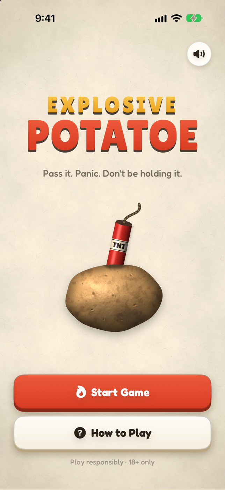
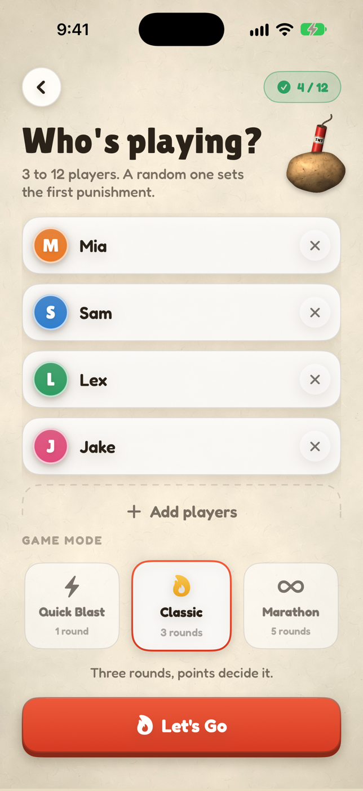
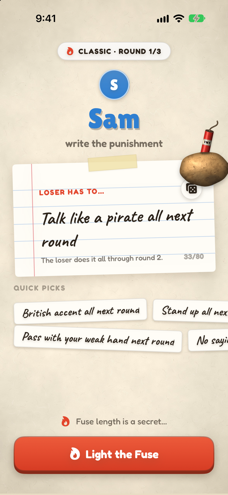
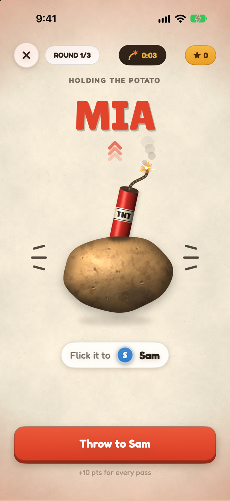
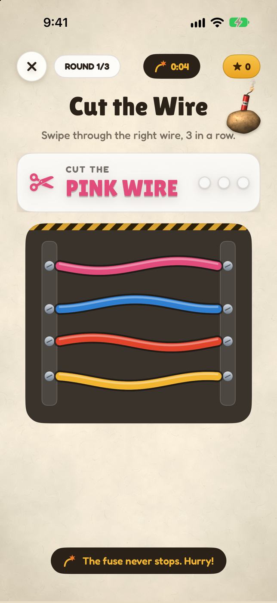
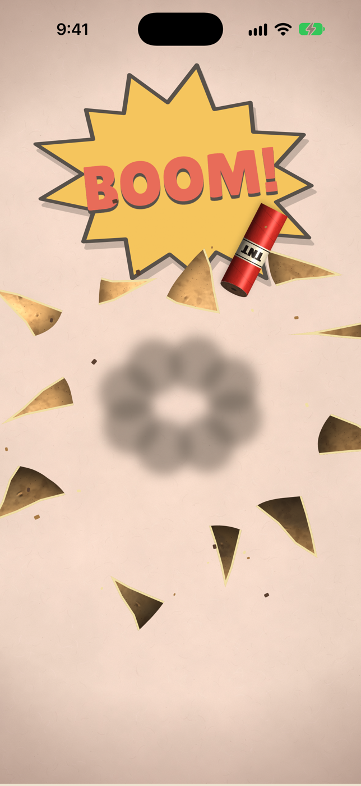
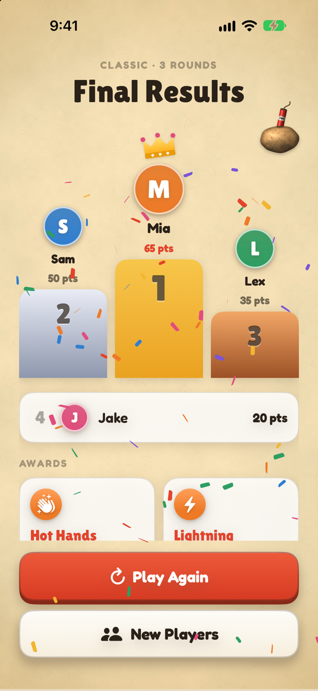

# Explosive Potatoe

An iOS hot potato party game built with SwiftUI. Players pass a phone around while a hidden fuse burns down, and whoever is holding it when it explodes takes the punishment the group wrote.

It's a playable game that's still being playtested and tuned.

## Screenshots

### Tabletop paper (Oct 11, 2026)

A paper-textured look with a realistic potato and a stick of dynamite that stays on screen the whole game and blows apart when the fuse runs out. Punishments are written on a note card.

  
  
  
  
  
  
  

### Night revamp (Oct 10, 2026)

A full redesign with a dark night theme, glowing buttons, sound effects, haptics, three game modes, and two new minigames.

  
  
  
  
  
  
  

### First playable UI (Oct 9, 2026)

The original cartoon look built from the Figma mockups.

  
  
  
  
  
  
  

## How it plays

1. Add 3 to 12 players and pick a mode: Quick Blast (1 round), Classic (3 rounds), or Marathon (5 rounds).
2. A random player writes the first punishment on a note card, then lights the fuse. Before the final round, punishments last through the next round. In the final round or Quick Blast, they're one-time dares.
3. A card flip decides whether the holder has to beat a minigame first.
4. The holder flicks the potato up to throw it to the next player. The throw happens in slow motion.
5. The catcher taps Catch as fast as they can. Faster catches earn more points, and missing the window costs points.
6. Whoever is holding the potato when the hidden fuse runs out loses the round and does the punishment.
7. After the last round, a podium ranks everyone by points and hands out awards.

## Minigames

The fuse never pauses, so you retry until you finish.

- **Hold and release:** fill the ring and let go inside the green zone
- **Tap 1 to 9:** tap the numbers in order, and a wrong tap reshuffles them
- **Sort the crates:** drag each crate into the matching colored bin
- **Fill the bucket:** tap fast to pour water in faster than it drains
- **Arrow rush:** swipe in the direction each arrow shows, six in a row
- **Cut the wire:** swipe through the wire color you're told, three in a row

## Tech

- SwiftUI with an `@Observable` game model
- One potato view lives above every screen, and each screen marks where it should sit, so the potato flies between screens instead of being redrawn
- Each minigame is a self-contained view that calls back when it's done
- Potato, dynamite, and paper art rendered with Core Graphics, sound effects synthesized in code, and haptics throughout
- Targets iOS 18

## Running it

1. Open `Explosive Potatoe.xcodeproj` in Xcode.
2. Pick an iPhone simulator or a connected iPhone.
3. Press Run.

## Status

Playable, with point values and fuse timing that still need playtesting. The sound effects are placeholders. The game is for ages 18 and up. Play responsibly.
