# Explosive Potatoe

An iOS hot potato party game built with SwiftUI. Players pass a phone around while a hidden fuse burns down, and whoever is holding it when it explodes takes the punishment the group wrote.

This is an early playable demo.

## Screenshots

### Night revamp (Oct 10, 2026)

A full redesign with a dark night theme, glowing buttons, sound effects, haptics, three game modes, and two new minigames.

  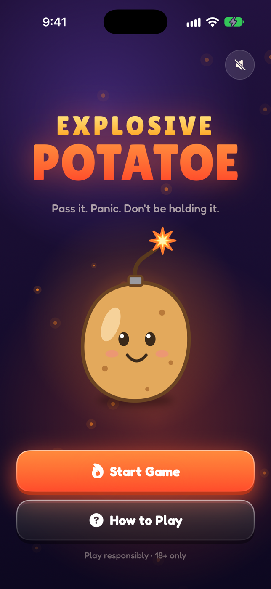
  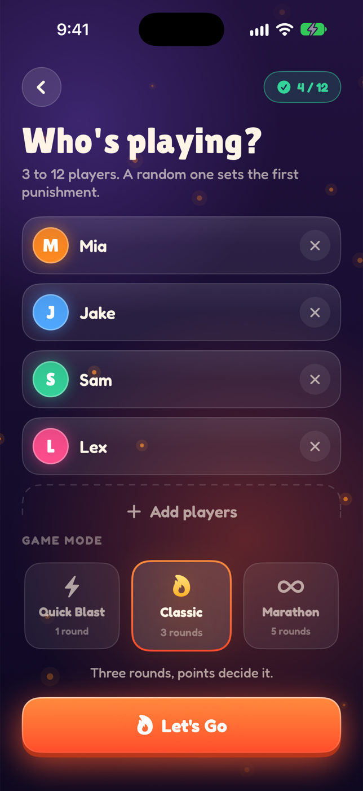
  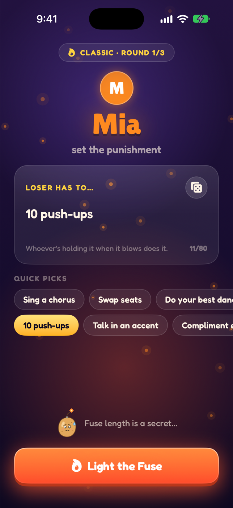
  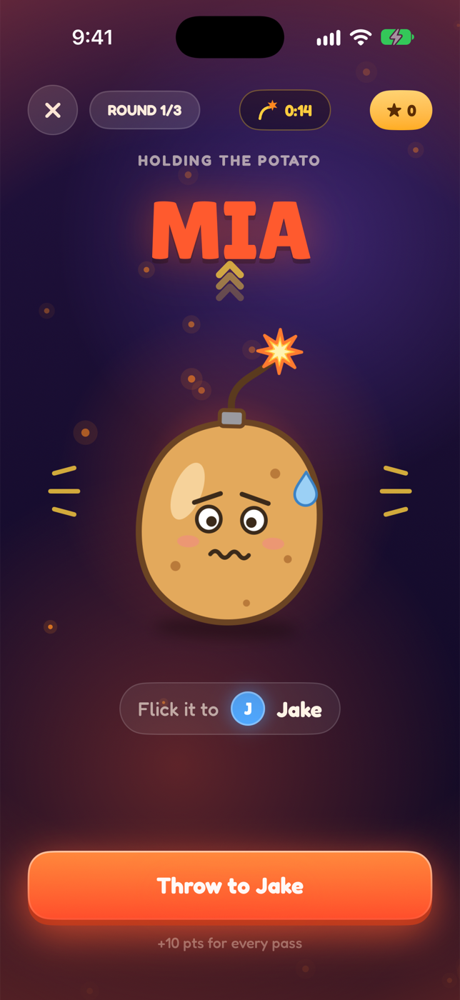
  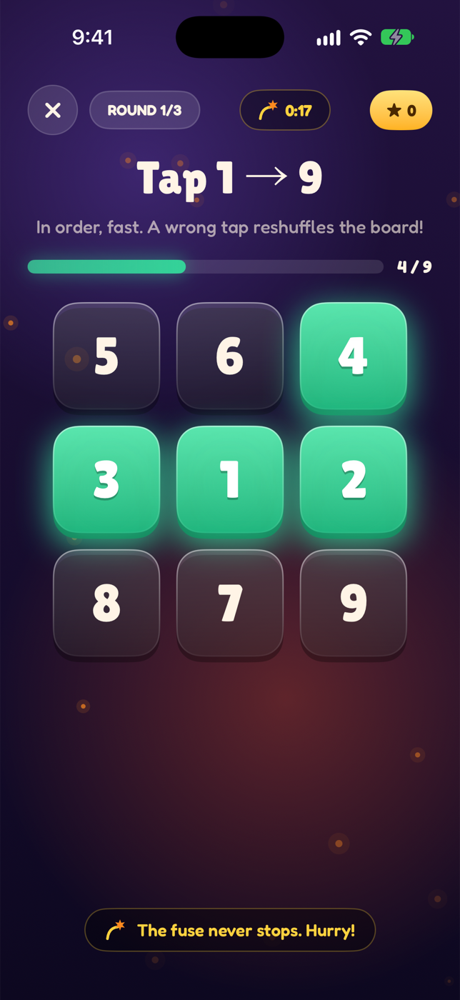
  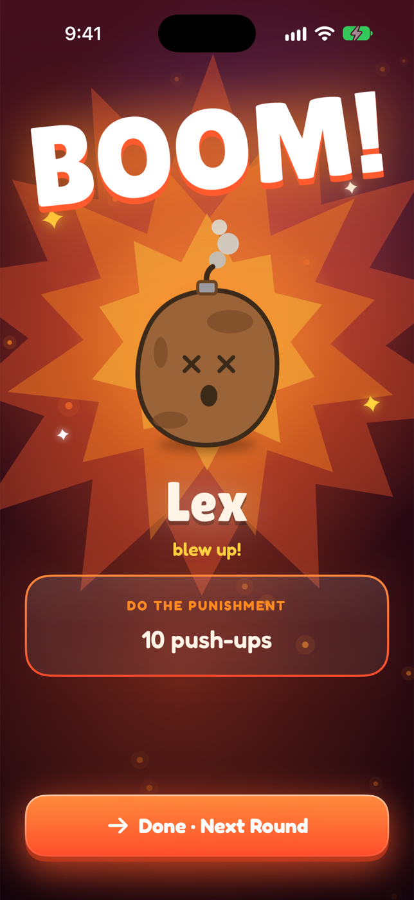
  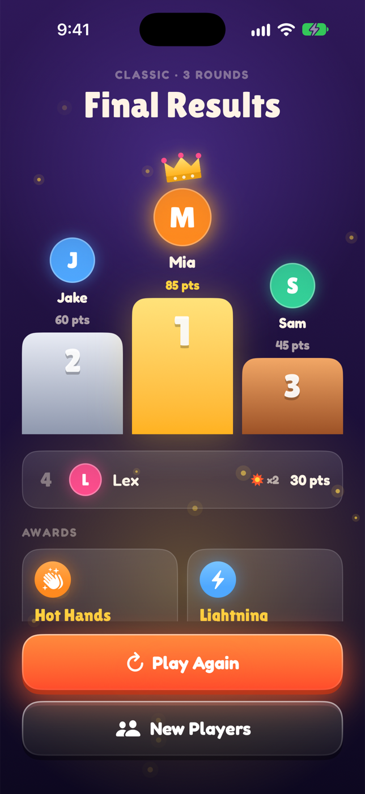

### First playable UI (Oct 9, 2026)

The original cartoon look built from the Figma mockups.

  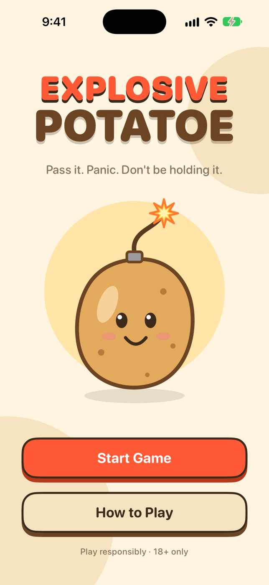
  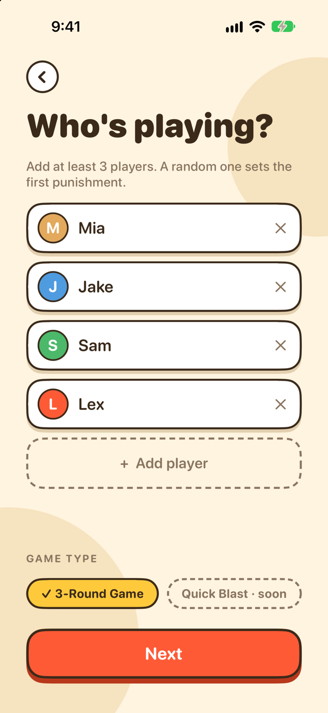
  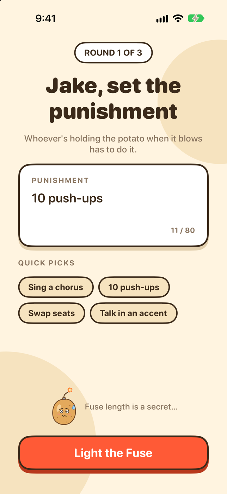
  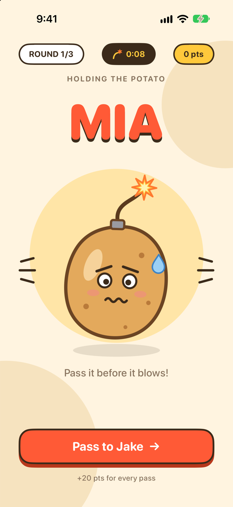
  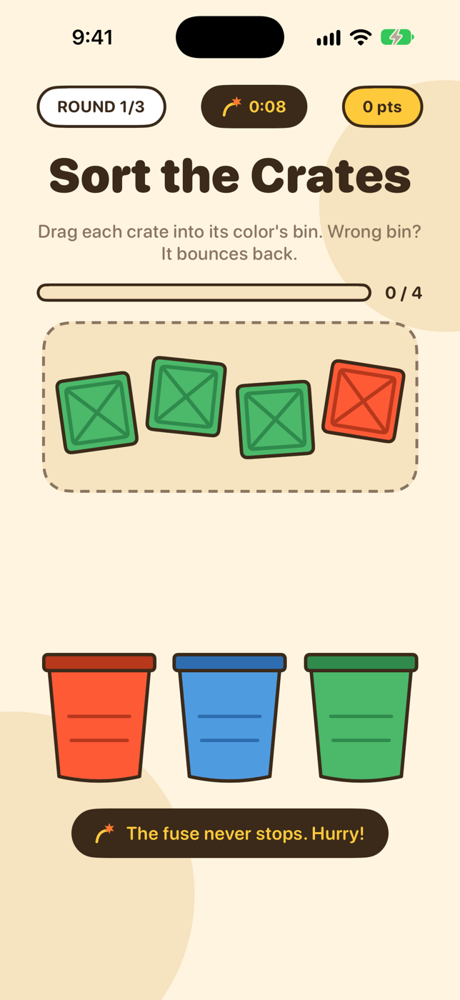
  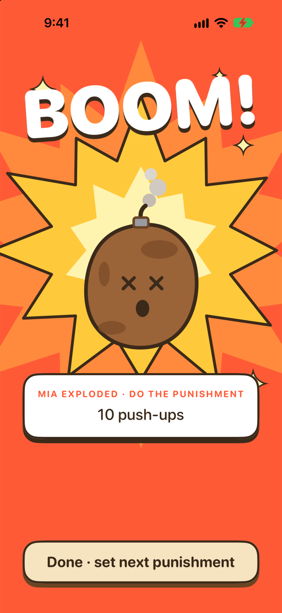
  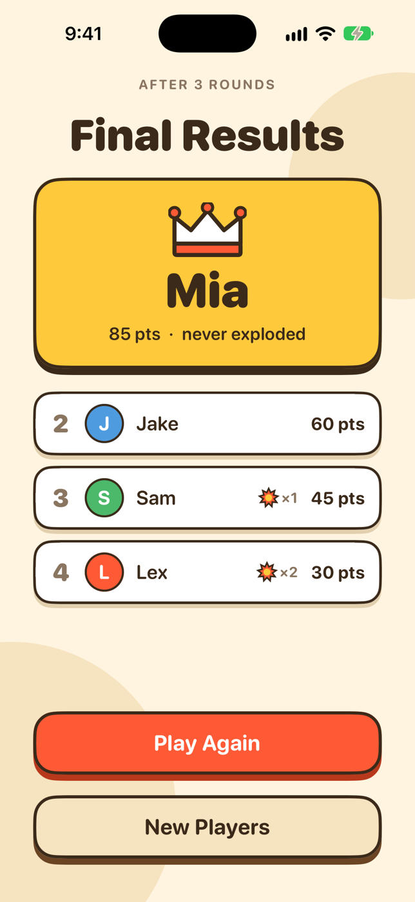

## How it plays

1. Add three or more players and pick a game type (a 3-round game for now).
2. A random player types the first punishment, then lights the fuse.
3. The current holder sees the potato and an elapsed fuse timer. The explosion time is a surprise.
4. When you receive the potato you tap to accept it, and a card flip decides whether you have to play a minigame.
5. Tap to pass it to the next player. The pass happens in slow motion.
6. The holder when it explodes loses the round and does the punishment.
7. After round 3, a results screen ranks everyone by points.

## Minigames

The fuse never pauses, so you retry until you finish.

- **Hold and release:** fill the ring and let go inside the green zone
- **Tap 1 to 9:** tap the numbers in order, and a wrong tap reshuffles them
- **Sort the crates:** drag each crate into the matching colored bin
- **Fill the bucket:** tap fast to pour water in faster than it drains

## Tech

- SwiftUI with an `@Observable` game model
- Each minigame is a self-contained view that calls back when it's done
- Art is drawn in SwiftUI and vector assets, with a cartoony look (cream background, thick outlines, hard shadows)
- Targets iOS 18

## Running it

1. Open `Explosive Potatoe.xcodeproj` in Xcode.
2. Pick an iPhone simulator or a connected iPhone.
3. Press Run.

## Status

Playable, with placeholder point values and fuse tuning that still need playtesting. Sounds, a final app icon, and custom fonts (Fredoka and Lilita One) aren't added yet. The game is for ages 18 and up. Play responsibly.
